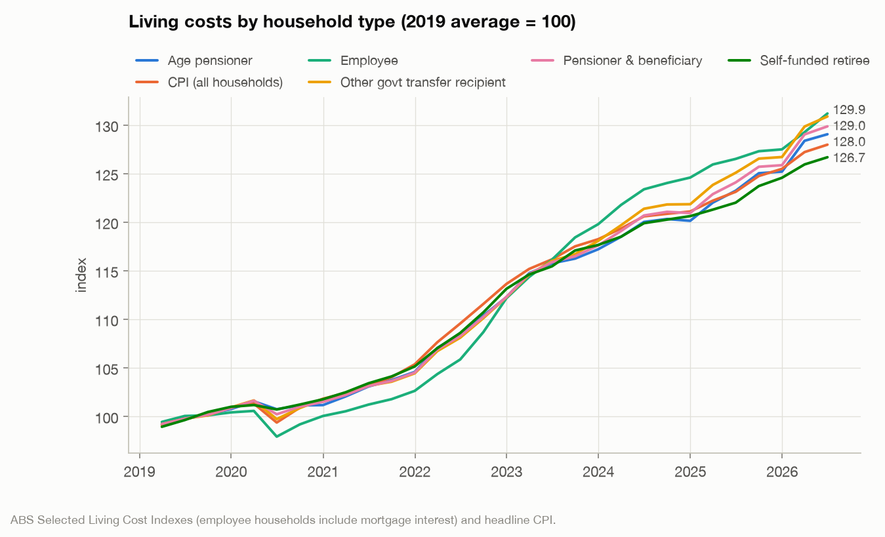
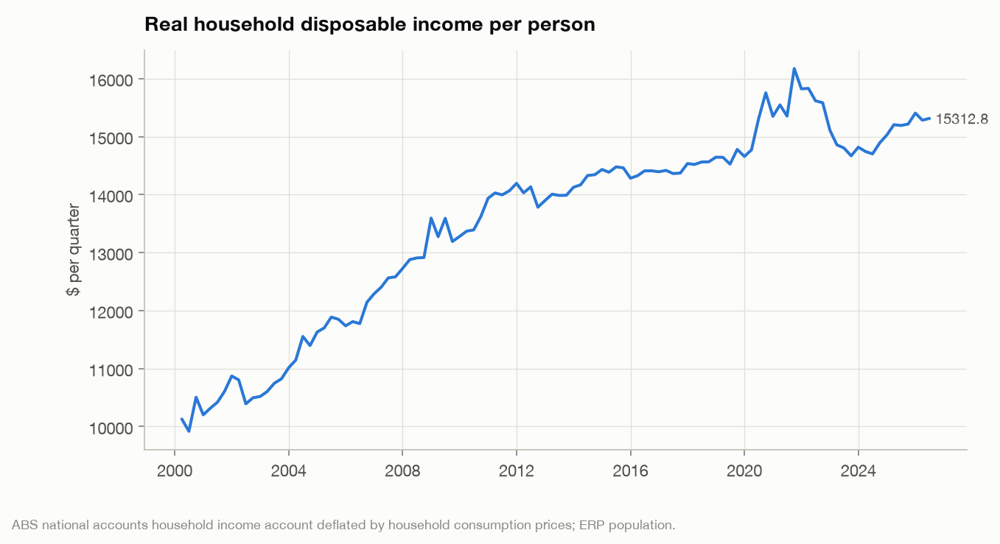
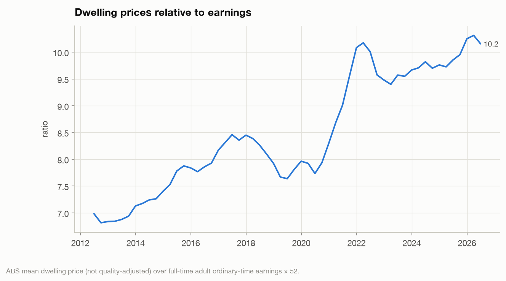
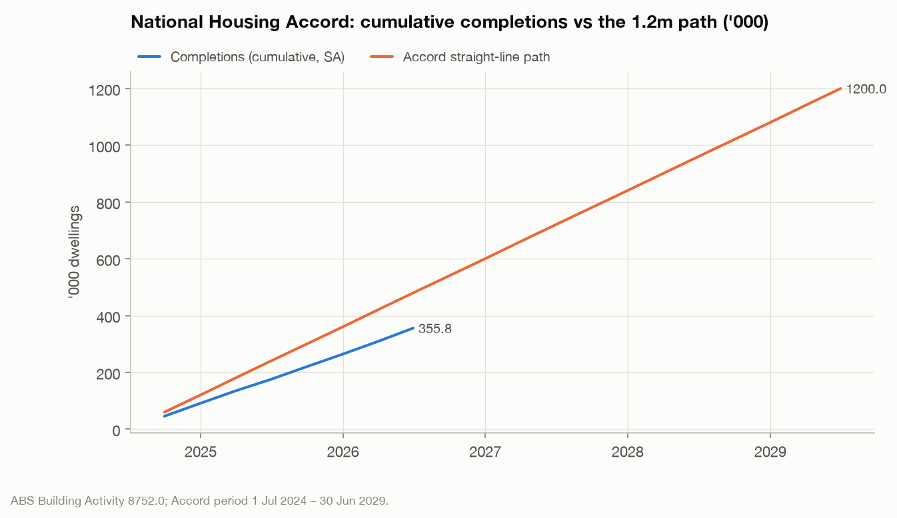
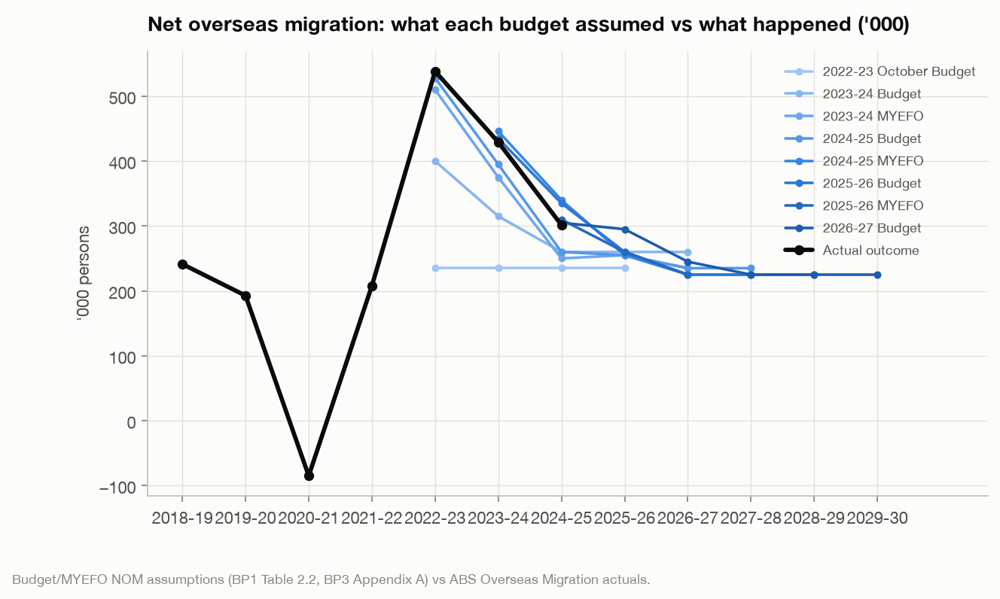
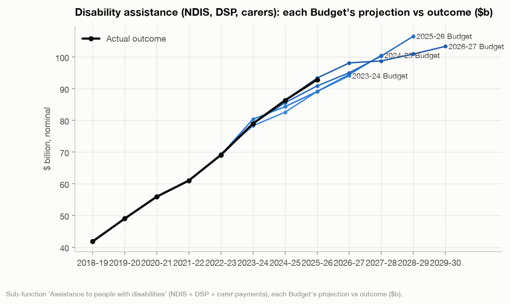
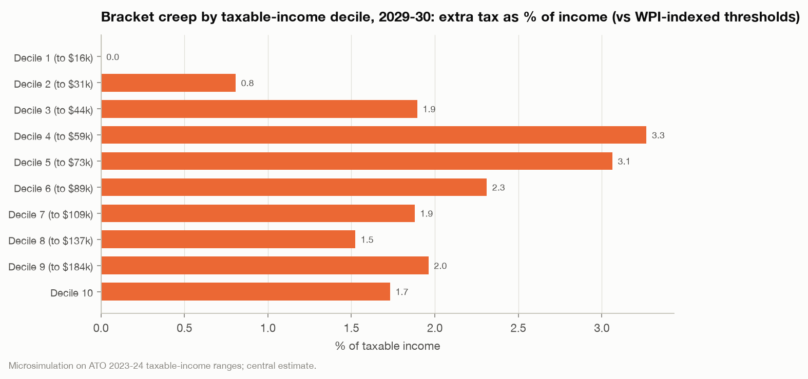
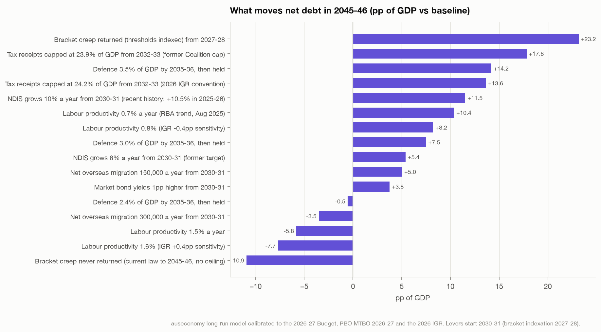

# Australia's economy: where we are, who it's working for, and what could change

*A question-led assessment generated from the `auseconomy` model on 26 October 2026. Data to the
June quarter 2026 (budget: 2025-26 actuals, 2026-27 Budget estimates). Every number below is computed from primary
data or tagged with its source. Confidence: [established] [contested] [estimate].*

## The one-page picture

1. **Living standards have stopped falling but have not recovered.** Real household disposable income per person is
   +4.5% vs 2019 but
   -5.3% below its 2021 peak; real wages
   are falling again (-0.7pp y/y) because inflation re-accelerated to 3.9%.
2. **Housing is the main thing making younger Australians worse off.** A mean-priced home costs
   10.2 years of full-time earnings (7.8 in 2019);
   completions are running at 74% of the Accord path.
3. **The budget is high-tax and high-spend, and since 2020 the forward "cuts" have not happened.** Payments
   26.8% of GDP, tax 24.0%. Before COVID, one-year-ahead spending forecasts
   were unbiased (+2.1%, not significant); since 2020 outcomes have beaten
   forecasts by 10% one year out and 17% three
   years out. Of the $143.0b added to payments since the 2023-24 Budget, 52% was new policy decisions
   and 48% parameter changes. Combined Commonwealth + state net debt heads from 31% to 36.5% of GDP by 2029-30.
4. **Bracket creep is the quiet tax rise.** Worth $34.3b a year
   by 2029-30, and heaviest, as a share of income, on people earning $44k–$73k. [estimate]
5. **Government spending growth is a weak lever on inflation.** Across every Commonwealth channel we can measure,
   the link to underlying inflation is small and disappears once COVID is excluded; inflation is dominated by its own
   persistence and expectations.
6. **Productivity is the real long-run problem, and the popular diagnoses are mostly wrong.** The post-2019 slowdown is
   ~90% within industries (chiefly weak business investment), not the shift of workers into care jobs; migration's
   skill mix added to productivity rather than diluting it. [established]

**Is the everyday Australian better off?**

| Indicator | Latest | Unit | As at | 1y change | vs 2019 | Percentile since 1990 | Trend | Official forecast |
|---|---|---|---|---|---|---|---|---|
| Real wage growth (WPI − CPI) | -0.7 | pp y/y | 2026-06 | -2.0 | -1.5 | 14 | mixed |  |
| Real household disposable income per person | 0.8 | % y/y | 2026-06 | -2.5 | 0.3 | 34 | mixed |  |
| Real net national disposable income per person | 0.0 | % y/y | 2026-06 | -0.4 | -2.2 | 25 | mixed |  |
| Living costs: employee households | 3.7 | % y/y | 2026-06 | 1.2 | 2.4 | 72 | mixed |  |
| Living costs: age pensioners | 4.7 | % y/y | 2026-06 | 2.0 | 3.0 | 85 | mixed |  |
| Household saving ratio | 6.5 | % of income | 2026-06 | 0.6 | 0.6 | 71 | mixed |  |

**Inflation and interest rates**

| Indicator | Latest | Unit | As at | 1y change | vs 2019 | Percentile since 1990 | Trend | Official forecast |
|---|---|---|---|---|---|---|---|---|
| Headline CPI | 3.9 | % y/y | 2026-06 | 1.8 | 2.4 | 82 | mixed |  |
| Underlying inflation (trimmed mean) | 3.6 | % y/y | 2026-06 | 1.0 | 2.1 | 84 | rising |  |
| Rents (CPI) | 3.5 | % y/y | 2026-06 | -1.0 | 3.2 | 68 | mixed |  |
| Cash rate | 4.3 | % | 2026-06 | 0.3 | 3.1 | 41 | mixed |  |
| Real cash rate | 0.6 | % | 2026-06 | -0.7 | 1.0 | 35 | mixed |  |
| Consumer inflation expectations (1y) | 5.5 | % | 2026-06 | 0.5 |  | 89 | rising |  |

**Jobs**

| Indicator | Latest | Unit | As at | 1y change | vs 2019 | Percentile since 1990 | Trend | Official forecast |
|---|---|---|---|---|---|---|---|---|
| Unemployment rate | 4.4 | % | 2026-06 | 0.3 | -0.7 | 16 | mixed |  |
| Participation rate | 66.8 | % | 2026-06 | -0.2 | 1.0 | 95 | mixed |  |
| Underutilisation rate | 10.9 | % | 2026-09 | 0.8 | -2.6 | 20 | rising |  |

**Growth and productivity**

| Indicator | Latest | Unit | As at | 1y change | vs 2019 | Percentile since 1990 | Trend | Official forecast |
|---|---|---|---|---|---|---|---|---|
| Real GDP growth | 2.1 | % y/y | 2026-06 | 0.2 | 0.2 | 26 | mixed |  |
| Real GDP per person growth | 1.1 | % y/y | 2026-03 | 1.3 | 0.6 | 41 | mixed |  |
| Labour productivity (GDP per hour) | 0.6 | % p.a. | 2025-26 | 1.1 | 0.4 | 28 | mixed |  |
| Market-sector labour productivity | 0.9 | % p.a. | 2025-26 | 1.1 | 0.7 | 29 | mixed |  |
| Multifactor productivity (market sector) | 0.7 | % p.a. | 2025-26 | 1.2 | 0.6 | 55 | mixed |  |
| Private demand growth | 3.5 | % y/y | 2026-06 | 1.5 | 3.6 | 53 | mixed |  |
| Public demand growth | 2.1 | % y/y | 2026-06 | -0.9 | -3.4 | 25 | mixed |  |
| Public demand share of GDP | 28.9 | % of GDP | 2026-06 | 0.1 | 3.1 | 98 | mixed |  |

**Housing**

| Indicator | Latest | Unit | As at | 1y change | vs 2019 | Percentile since 1990 | Trend | Official forecast |
|---|---|---|---|---|---|---|---|---|
| Dwelling price to full-time earnings | 10.2 | ratio | 2026-06 | 0.3 | 2.4 | 93 | mixed |  |
| Mortgage repayment on a mean-priced home | 63.3 | % of one FT income | 2026-06 | 3.5 | 29.0 | 98 | rising |  |
| Rent relative to wages | 101.8 | index, 2019=100 | 2026-06 | 0.3 | 1.8 | 50 | mixed |  |
| Dwelling completions per 1,000 people (annualised) | 6.7 | per 1,000 | 2026-06 | 0.8 | -1.3 | 22 | mixed |  |
| Dwelling approvals (4-quarter total) | 205,593 | dwellings | 2026-06 | 17,649.0 | 19,932.8 | 85 | rising |  |
| Housing Accord: completions vs target path | 74.1 | % of path | 2026-06 | 1.1 |  |  | rising |  |

**The Commonwealth budget**

| Indicator | Latest | Unit | As at | 1y change | vs 2019 | Percentile since 1990 | Trend | Official forecast |
|---|---|---|---|---|---|---|---|---|
| Underlying cash balance | -0.8 | % of GDP | 2025-26 | -0.4 | -0.7 | 49 | falling | -0.7 (2029-30) |
| Payments | 26.8 | % of GDP | 2025-26 | 0.7 | 2.4 | 92 | rising | 26.6 (2029-30) |
| Tax receipts | 24.0 | % of GDP | 2025-26 | 0.3 | 1.1 | 92 | rising | 23.8 (2029-30) |
| Net debt | 19.2 | % of GDP | 2024-25 | 0.8 | 0.1 | 89 | mixed | 22.2 (2029-30) |
| Net interest payments | 0.6 | % of GDP | 2025-26 | 0.1 | -0.2 | 35 | mixed | 0.9 (2029-30) |
| Commonwealth fiscal impulse | 0.5 | pp of GDP | 2026-06 | -0.6 | 0.7 | 67 | falling |  |
| Average personal tax rate (tax / employee income) | 26.1 | % | 2023-24 | 0.9 | 1.8 | 96 | rising | 25.5 (2029-30) |

**Trade, exchange rate and energy**

| Indicator | Latest | Unit | As at | 1y change | vs 2019 | Percentile since 1990 | Trend | Official forecast |
|---|---|---|---|---|---|---|---|---|
| Current account balance | -3.7 | % of GDP | 2026-06 | -1.3 | -3.5 | 44 | falling |  |
| Terms of trade | 94.8 | index | 2026-06 | -0.5 | 7.3 | 80 | mixed |  |
| Trade-weighted exchange rate | 65.8 | index | 2026-06 | 6.0 | 5.8 | 65 | rising |  |
| Electricity prices (CPI) | 22.0 | % y/y | 2026-06 | 28.2 | 23.7 | 97 | mixed |  |
| Gas prices (CPI) | 5.9 | % y/y | 2026-06 | 0.2 | 5.5 | 65 | mixed |  |

**Population and migration**

| Indicator | Latest | Unit | As at | 1y change | vs 2019 | Percentile since 1990 | Trend | Official forecast |
|---|---|---|---|---|---|---|---|---|
| Net overseas migration | 301,500 | persons | 2024-25 | -127,700.0 | 60,200.0 | 92 | mixed |  |
| Population growth | 1.5 | % p.a. | 2024-25 | -0.5 | 0.0 | 64 | mixed |  |
| Ageing premium (age-cost-weighted vs raw population growth) | 1.3 | pp p.a. | 2024-25 | 0.4 | 0.3 | 92 | mixed |  |

*Percentile: where today's reading sits in the indicator's own history since 1990 (100 = highest ever).*

## 1. Is the everyday Australian better off?

**Short answer.** Than in 2019: slightly, on average, and only if you already owned a home. Than in 2021-22: no. Real
income per person peaked in Sep 2021, fell through the inflation surge, recovered a little
in 2025, and is now flat because inflation is back near 4% while wages grow 3.2%. Renters, young
households and pensioners have done worse than the averages suggest.

**What the data shows.**
* Real household disposable income per person: +4.5% vs
  2019, -5.3% vs the peak. Real net national
  disposable income per person (which includes the terms-of-trade windfall) is
  -4.1% below its 2022 peak.
* Real wages: the Wage Price Index is up 22.2% since 2019,
  CPI 28.0%: a real wage cut of about
  -4.5%
  for the same job. Real wages are falling again (-0.7pp y/y in June 2026).
* Living costs since 2019: employee households +31% (mortgage interest), age pensioners
  +29%, self-funded retirees +27%, vs CPI
  +28%. Pensioners currently face the fastest cost growth (4.7% y/y).
* Wealth: median net worth of 55-64 households was 5.7x that of 25-34s in 2019-20 ($1.00m vs
  $176k). That survey predates a 60% rise in dwelling prices, so the gap today is almost certainly wider.
* Jobs (September 2026): unemployment 4.6%, underutilisation 10.9% (13.5% in 2019): the labour
  market is still tighter than pre-COVID, which is why income held up as well as it did.

**Nuance and measurement audit.**
* "Per person" averages are pulled up by high earners and by the mining windfall. The ABS wealth survey stopped at
  2019-20 (no 2022-23 edition was run), so the official picture of who gained from the 2020-26 asset boom is six years old.
* The CPI excludes mortgage interest; the living-cost index for employees includes it, which is why employees' costs
  rose fastest. Renters sit inside "employee" and "other transfer recipient" households and are not separately reported.
* Real wage comparisons use WPI, which tracks pay for the same job; actual earnings grew faster as people moved jobs.

**What could be done.** The two levers with the most direct effect on everyday incomes are (a) getting inflation
back inside the band so real wages stop falling (section 7), and (b) housing supply and the tax settings that allocate
housing (section 2). Index-linked payments protect pensioners; employee households have no equivalent protection
against mortgage-rate rises.

**Drill down.** Tables `household_income`, `living_costs`, `affordability`, `wealth_by_age`; `assess.assess("living")`.

## 2. Housing: what is actually driving it, and what would move it?

**Short answer.** Supply has been running at its lowest rate per person since the early 1980s while population grew at
a record pace; that combination, not any single policy, is why prices and rents detached from incomes. The Accord target
will be missed by about a quarter, though building is now accelerating. The 2026 tax changes (CGT indexation, negative
gearing limited to new builds) are a real shift in the demand side, but grandfathering means they bite slowly.

**What the data shows.**
* Completions per 1,000 residents: 6.7 (annualised, June 2026) against a 1985-2019 average of
  7.9; the Dec-2025 and Mar-2026 readings were the lowest since 1981.
* Accord: 356k completions in the first two years vs 480k on the
  straight-line path (74%). The remaining three years need
  70k a quarter; the current pace is 45k, projecting
  about 897k by mid-2029. [estimate] The pipeline is improving: approvals are the
  highest since 2021 and a record 249k dwellings are under construction.
* Prices: mean dwelling price $1.10m, 10.2x full-time earnings
  (7.8x in 2019). Indicative repayments on an 80% loan take
  63% of one full-time income (34% in 2019). [estimate]
* Rents: CPI rents +3.5% y/y, down from a 7.8% peak; since 2019 rents have tracked wages
  (rent-to-wage index 102). Advertised rents run faster (+5.5%, Cotality) [tax_housing].
* Demand: net overseas migration peaked at 538k (2022-23), 302k in 2024-25, and the Budget assumes 295k in 2025-26 and
  245k in 2026-27 (section 3). At 2.5 people per dwelling, each 100k of NOM needs ~40k homes.

**Nuance and measurement audit.**
* The 1.2m target is above underlying demand: NHSAC's 2026 State of the Housing System puts demand over the Accord period
  at ~900k vs ~862k net supply, so the "shortfall" against need is ~37k, not ~300k. [contested] Both numbers depend on
  household-formation assumptions that respond to prices.
* "Completions" counts all dwellings, nets off no demolitions and tests nothing about location or price point.
* Construction productivity is the binding constraint the debate under-weights: dwellings completed per hour worked
  have fallen 53% in 30 years (PC 2025) [productivity]. Approvals rising faster than completions is consistent with that.
* Price effects of the 2026 tax package: Treasury ~−2pp over a couple of years, CBA ~−3%, Grattan −1 to −4%; all
  model-based, none observed yet. [contested] Grandfathering (established properties held at 12 May 2026 keep negative
  gearing) protects incumbents and slows the adjustment.
* The 5% deposit scheme (income caps removed Oct 2025, 22,921 guarantees in four months) adds demand at the margin
  where supply is least elastic; Treasury's +0.5–0.6% price estimate is unaudited. [contested]

**What could be done.** The evidence points at (1) construction capacity and productivity (approvals, trades, materials,
and the planning process that makes medium-density slow), (2) sustaining the lower migration path the Budget already
assumes rather than cutting further (section 3 shows the fiscal cost of deeper cuts), (3) letting the 2026 tax
changes work rather than reversing them, and (4) not adding demand subsidies. Rent assistance indexation protects the
most exposed renters at low fiscal cost.

**Drill down.** `housing_quarterly`, `accord_tracker`, `affordability`; `assess.assess("housing")`.

## 3. Immigration: if we cut it, what flows where?

**Short answer.** Migration ran far above every forecast in 2022-24, which strained housing and made per-person income
look worse than total GDP. It has since halved and the Budget assumes it keeps falling to 225k. Cutting it further would
ease rents a little, reduce per-capita GDP growth only through arithmetic, worsen the budget, and speed up ageing.
The strongest evidence is on rents and the fiscal side; the weakest is on wages and infrastructure.

**What the data shows.**
* NOM: 538k (2022-23), 429k, 302k (2024-25);
  244k in the first three quarters of 2025-26. NOM was
  74% of population growth in 2024-25.
* Forecast record: the October 2022 Budget assumed 235k for 2022-23; the outcome was 538k. The May 2023 Budget was
  114k low for 2023-24. Since late 2024 forecasts have been slightly too high. The pattern: forecasts anchor to a
  "normal" 225–235k and miss the swings. [established]
* Rents: a NOM rate 1pp of population higher (≈280k people) is associated with rent inflation 3–8pp higher over the
  following year (HAC regressions, 1982–2026 and 2006–2019 samples). [estimate, association] The RBA's housing model
  gives ~0.5% on rents per 50k people [immigration]: consistent in sign, smaller in size, because it controls for supply.
* Per-capita GDP: the mechanical effect of population on the denominator explains most of the "per-capita recession";
  our regressions find −1 to −2pp of per-capita growth per 1pp NOM rate, of which −1 is pure arithmetic. [estimate]
* Fiscal: Treasury's lifetime estimate is +$127k per permanent migrant vs the general population (+$415k for primary
  skilled, −$400k humanitarian, −$394k parent visas) [immigration]. The PBO costed the Coalition's 2025 proposal to cut
  the permanent program from 185k to 140k at −$3.4b over four years for the Commonwealth budget. [established]
* Ageing: the age-cost-weighted population grows about 1.4pp a year faster than the raw population over
  2025-2030. With zero migration, population growth would fall to ~0.3% but age-related cost growth would barely
  change (2.1% vs 2.7%): migration dilutes the cost per person rather than removing it. [estimate]
* Productivity: labour composition *added* ~0.3pp a year over 2017-22 (ABS); the RBA finds less-skilled entry explains
  "only a small share" of weak productivity. [established]

**Nuance and measurement audit.**
* NOM is measured on a 12-in-16-month rule and revised for up to two years; the latest year is preliminary.
* The rent regressions do not control for supply or the cycle, so treat them as upper bounds. Student numbers drive
  rents in specific suburbs more than nationally.
* The "$100k of infrastructure per migrant" figure in circulation has no transparent method. [contested]
* Current settings (Oct 2026): Labor 185k permanent, NOM target 245k then 225k, student planning level 295k;
  Coalition 100k NOM for two years then tied to housing completions; One Nation ~130k ceiling. [immigration]

**What could be done.** The question is composition and volatility more than level. The fiscal and productivity
evidence favours keeping skilled permanent migration and tightening the temporary/student channels that drove the
2022-24 surge; tying intake to housing completions (as the Coalition proposes) is coherent in principle but would
make migration pro-cyclical with construction. A 100k NOM path would, on the numbers above, lower rents by low single
digits over several years, cost the budget several billion a year, and raise the dependency ratio faster.

**Drill down.** `population_components_fy`, `nom_vintages`, `ageing`, `migration_by_visa`; `population.nom_regressions()`.

## 4. Is the government spending money unnecessarily, for example on the NDIS?

**Short answer.** "Unnecessary" is a value judgement the data can't make, but it can answer three narrower questions.
Is the NDIS costing far more than planned? Yes, by every vintage: 782,000 participants against a 2011 design of
411,000, $51b against a 2017 projection of $35b for this year. Has it grown beyond its intent? Yes: a third to 40% of
today's spending sits outside the original scope, mostly children with developmental needs for whom the scheme became
the only door, plus plan inflation and ~8% leakage. Is it being cut? **Yes, since 1 October 2026**: the Amendment Act
(passed 19 Aug 2026) cut social and community participation budgets by 50% and daily-living budgets by 10%, and Treasury
projects participants falling from 783,000 to 632,000 by 2030 (895,000 without reform). The *aggregate* line still
rises in dollars because wages and remaining participants' plans grow. Do we know what the money buys? Partly: the
NDIA and AIHW publish employment and participation outcomes (open employment at award wages 20% → 25% since 2021),
but nothing tests whether $51b buys more than $40b would.

**What the data shows.**
* Disability assistance (NDIS + Disability Support Pension + carers) was $92.9b in 2025-26,
  11% of all Commonwealth expenses and the third-largest line after
  the age pension/aged care and GST payments to the states.
* NDIS participant costs: $27.9b (2021-22) → $51.2b (2025-26), +10.5% in the latest year, 18.7% a year on average over five
  years; 782,013 participants at June 2026. [ndis_redistribution]
* The forecast record (chart): the 2023-24 Budget projected 2026-27 disability spending at
  $94.1b; the 2026-27 Budget now has $98.1b. Each budget
  revised the near years up and projected a slowdown that then didn't arrive. The 2026-27 Budget again projects the
  line nearly flat: $98.1b → $103.4b over three years, after +10.5%.
* The "Securing the NDIS" reforms claim $37.8b of savings over four years, but $13.9b of that is against a projection
  that had itself been revised up; against the previous Budget the saving is $23.9b, and Grattan attributes $13.2b of
  it to across-the-board cuts to participant budgets rather than eligibility reform. [ndis_redistribution] [contested]
* Growth target: 8% was superseded by a 5–6% National Cabinet target; actual 2025-26 growth was 10.5%. The PBO's
  10%-growth scenario adds $68b to annual spending by 2036-37. [established]
* Who pays: the Commonwealth about 75%, states ~25%, with state contributions capped at 4% growth to 2027-28. Of the
  $185b in projected savings to 2036-37, only $32.5b flows to the states. [estimate]

**Nuance and measurement audit.**
* Three different "NDIS" numbers circulate and are easy to mix: participant supports ($51.2b, 2025-26), the Budget
  program line including state contributions ($56.1b, 2026-27), and the disability sub-function that adds the DSP and
  carer payments ($92.9b). This section labels which is which.
* Growth is both numbers *and* plans: headcount +6% last year against spending +10.5%; the average payment rose 2.4%
  over two years but *the same participants'* payments rose 6% in a year. Children drive the headcount (11% of all
  six-year-olds; 78% of entrants autism/developmental delay) but not most of the dollars: a non-SIL child with autism
  averages ~$28k against a $67.5k scheme average, while 4.7% of participants in supported independent living cost
  $16.6b ($452k each). [established]
* Leakage: the NDIA's statistically usable estimate is 8.2–8.3% of claims (~$3.7b), which it cannot split between
  organised fraud (~1.3% "likely serious offending"), opportunism and error; pre-2024 prevention controls checked
  0.4% of dollars and cancelled more than half of what they checked (ANAO 2025). Serious, but not the growth driver.
  [established] An independent Grok/X-search critique of this section (`reports/grok/`) reached the same reading.
* A budget line "lower than previously forecast" is not a cut. Scoring every budget update since 2008-09 against
  outcomes: pre-COVID forecasts of total expenses were close to unbiased (one year ahead
  +2.1%, three years +1.3%, neither significant);
  post-2020 they have been too low by 10% / 13% /
  17% at one, two and three years. Of the $143.0b added to 2023-24 to 2026-27 payments
  across the seven updates since the 2023-24 Budget, policy decisions account for $73.6b and parameter/other
  variations $69.3b: the overruns are half chosen, half demand-driven. [established] (`reconciliation`,
  `reconciliation`).
* Comparable programs: aged care ($41b → $51b by 2029-30, and $73b by 2036-37 per PBO), hospital grants to states
  (+8.6% a year in the forward estimates), and the DSP ($26b → $40b by 2036-37) show the same demographic and demand
  dynamics. These, not "waste", are where the money is.

**What could be done.** The highest-value fix is measurement: fund an outcomes framework so eligibility and pricing
decisions can be made on evidence. On cost, the levers are eligibility (the functional-capacity test from 2028),
pricing (differentiated pricing is still only under consultation), provider integrity, and the foundational-supports
system that is supposed to divert children from the scheme. Holding growth to 5–6% while population ages 1.4pp a year
faster than it grows is ambitious; the model's forecast-error history says to budget for 8%.

**Drill down.** `expense_vintages` (filter subfunction), `programs` (NDIA lines), `reports/research/ndis_redistribution.md`.

## 5. Tax: bracket creep, the 2026 package, and starting a business young

**Short answer.** The personal income tax take is at a record share of the economy and the Budget has it rising further:
not because rates went up, but because thresholds don't move with wages. The 2026 package (CGT indexation, negative
gearing to new builds, Div 296, a trust minimum tax) shifts the burden toward capital income and funds modest rate
cuts, but bracket creep gives most of those cuts back within a few years. For a young founder the system is neutral to
mildly favourable on business income itself; the disadvantages are indirect (housing costs, HELP, and the loss of the
CGT discount on an eventual exit).

**What the data shows.**
* Average personal tax rate (individuals' tax ÷ employee income): 26.1% in 2023-24, the highest
  on record; the PBO's broader measure goes from 24.9% (2026-27) to 28.6% by 2036-37 without further cuts. [established]
* Bracket creep since 2024-25 (thresholds indexed to wages as the counterfactual): $5.1b in 2025-26 rising to
  **$34.3b** in 2029-30 ($26.9b on a CPI benchmark); ~$1,900 per taxpayer. The legislated
  15%/14% rate cuts and the $250 offset hand back about $11b in 2027-28, so net creep is still ~$22b by 2029-30. [estimate]
* Since 2010-11, a frozen schedule would raise $63b more than an indexed one; tax cuts returned $51b; net "stealth tax"
  ≈ $13.0b a year today. [estimate]
* Incidence: as a share of income, creep peaks in deciles 4–5 ($44k–$73k) at 3.1–3.3%, vs 1.7% in the top decile; the
  top decile still pays 30% of the dollars. Indexing thresholds is therefore progressive at the middle. [estimate]
* The 2026 package: CGT 50% discount → indexation + 30% minimum tax from 1 July 2027 (+$3.6b over five years, PBO ~$40b
  over ten); negative gearing limited to new builds for properties bought after 12 May 2026; Div 296 (30%/40% on super
  earnings above $3m/$10m) from 1 July 2026; 30% minimum tax on discretionary trusts from 1 July 2028 (+$4.5b in
  2029-30, not yet legislated). Whole package: +$77b to 2036-37. [established] Distribution of the concessions removed:
  83% of the CGT discount went to the top income decile. [established, taxable-income basis]

**Starting a business at 25–35 under 2026-27 settings** [small_business]:
* On business income the system is close to neutral: a company fully distributing profit is taxed the same as a sole
  trader via imputation; retaining profit defers at 25%. Effective rates at $60k / $100k / $150k / $250k profit:
  16% / 22.5% / 26.4% / 33.3% (sole trader or fully franked), 12–28% if paid as salary with 12% super. [estimate]
* Helpful: $20k instant asset write-off made permanent (announced), loss carry-back returning, small-business CGT
  concessions preserved, ESVCLP cap lifted, HELP 20% debt cut and a higher repayment threshold ($69.5k).
* Traps: the start-up loss refund and carry-back are capped by PAYG withholding/franking, so they do little for a
  founder without staff; interest on tax debts is no longer deductible; payday super (7 days) from July 2026; the
  trust minimum tax makes a company the default vehicle; founders' share exits lose the CGT discount from July 2027
  with no carve-out (a consultation was promised); threshold cliffs at $10m/$50m turnover. [established]
* The bigger structural point: the tax system's largest remaining concessions (main residence, super) still favour
  holding assets over building businesses, and housing costs absorb the savings a young founder would otherwise risk.

**Nuance and measurement audit.** Treasury's and the PBO's average-tax-rate series use different denominators (don't
splice them); our microsimulation matches ATO 2023-24 net tax within 1.8% and the PBO's no-policy-change creep rate
(0.42pp vs 0.40pp a year) but is ~0.5pp lower by 2029-30 because it uprates all incomes at WPI and misses composition
effects. Distributional tables (TEIS) rank by taxable income, which misclassifies asset-rich, low-taxable-income
households as poor.

**What could be done.** Index thresholds to CPI (cost ~$35b over four years on the PBO's SMART model, versus the
Coalition's $22.5b claim) [contested], funded by the capital-income base the 2026 package began to broaden; publish
bracket-creep revenue explicitly each Budget; give founders' equity the same treatment as new-build housing under the
new CGT rules if the aim is to favour risk-taking over asset-holding.

**Drill down.** `tax_burden_annual`, `bracket_creep`, `tax_schedule`, `tax_expenditures`; `taxburden.simulate(...)`.

## 6. Productivity: why is it so weak, and what would fix it?

**Short answer.** Output per hour has barely grown since 2019 (0.2% a year vs
1.1% in the 2010s). About three-quarters of the market-sector slowdown is
businesses investing less per worker (capital shallowing), not workers getting less efficient; the shift of workers
into care jobs explains under a tenth. The 2025 reform agenda is being legislated but has produced no measurable
payoff yet, and official assumptions disagree by nearly a factor of two (Treasury 1.2%, RBA 0.7%).

**What the data shows** (% a year, average):

| Measure | 2010-19 | 2019-26 | change |
|---|---|---|---|
| GDP per hour | 1.07 | 0.16 | -0.91 |
| Market-sector labour productivity | 1.52 | 0.52 | -1.00 |
|   of which MFP | 0.61 | 0.33 | -0.28 |
|   of which capital deepening | 0.91 | 0.19 | -0.72 |

* Shift-share across 19 industries: of the ~1pp slowdown, within-industry productivity accounts for −1.1pp (mining
  alone −0.8pp as grades fell), reallocation of hours +0.15pp, and the move into health, education and public
  administration −0.08pp (about 8%). Excluding mining, the slowdown is 0.25pp, of which the care shift is 0.04pp. [estimate,
  reproduces PC benchmarks exactly]
* Non-market productivity is −2.7% since 2014 while the market sector is +7.5%; but non-market output is measured from
  inputs, so this is partly a measurement artefact. [established]
* Jobs: non-market industries supplied 50% of all job growth since
  2019 from a 26% base; health care alone 32%. That is where the NDIS and aged
  care money went.
* Capital: capital services growth fell from 3.2% to 1.8% a year while hours growth rose. Non-mining capex is now
  rising, mostly data centres. [established]

**Nuance and measurement audit.**
* Mining's price-driven output share inflates both its drag and the offsetting reallocation; read the ex-mining run.
* The latest national accounts revised 2023-24 productivity down (0.96% → 0.5%), a reminder that recent readings move.
* Claims that migration dilutes skills are contradicted by the ABS labour-composition data (+0.3pp a year). [established]
* The PC's AI estimate (+4.3% over a decade) is an interim figure with wide bands; two-thirds of firms use AI, under
  10% call it significant. [contested]

**What could be done.** The evidence ranks: (1) investment: the PC's company tax/cash-flow tax proposal was not adopted;
the Budget chose smaller instruments (permanent write-off, carry-back); (2) housing and construction productivity,
which is both a housing and a productivity problem; (3) competition and dynamism (new-firm share fell from 13% to 11%),
including the non-compete ban still in draft; (4) approvals (EPBC reforms passed; the regulator started July 2026).
Measuring non-market output properly would change the headline number but not the underlying problem.

**Drill down.** `productivity_annual`, `productivity_industry`, `employment_growth_split`; `productivity.shift_share()`.

## 7. Inflation: is government spending the problem, and how do we get it down?

**Short answer.** Underlying inflation is 3.6% and rising again; the cash rate is back at
4.25%. Government spending is a popular explanation, but across every Commonwealth channel we can measure
(cash transfers, consumption, grants, total expenses, the fiscal impulse) the link to underlying inflation is small, and
it disappears once 2020-21 is excluded. Inflation's own persistence and expectations do most of the work. Fiscal
restraint helps at the margin by taking pressure off rates; it is not a substitute for them.

**What the data shows.**
* Augmented Phillips curve (1994–2026, HAC): public demand growth +0.07pp per 1pp (p = 0.13); Commonwealth real
  transfers +0.023pp (p = 0.002 on the full sample, **0.000, p = 1.0 ex-COVID**); consumption, grants and total expenses
  not significant on any sample. Local projections at 8 quarters: all within ±0.03pp. Out of sample, adding any fiscal
  variable does not improve inflation forecasts; an autoregression beats the structural models. [estimate]
* The fiscal impulse (change in the primary balance) Granger-causes inflation on the full sample (p < 0.001) but not
  ex-COVID (p = 0.71); one ex-COVID horizon shows +0.27pp per 1pp of GDP at 8 quarters. Treat as a hypothesis. [estimate]
* Current drivers (model attribution, June 2026): persistence and expectations explain almost all of the excess over
  2.7%; public demand contributes ~0.1pp; the energy-rebate unwind added ~0.6pp to *headline* CPI (electricity +22% y/y
  after −25% a year earlier), which is why headline (3.9%) exceeds underlying (3.6%).
* Public demand is a record 28.9% of GDP; the Commonwealth fiscal impulse turned mildly
  expansionary in 2025-26 (+0.5pp of GDP).

**Nuance and measurement audit.** These are associations: spending responds to the cycle and the RBA responds to
spending, which masks any direct effect. "Public demand" excludes transfers; the GFS channel analysis fixes that and
finds the same thing. Energy rebates lowered measured CPI in 2024-25 and are now raising it; underlying measures strip
this out. Consumer inflation expectations (5.5%) sit well above economists' (3.0%); which one drives wage-setting is
contested.

**What could be done.** The levers with evidence behind them: keep the fiscal impulse neutral-to-contractionary while
inflation is above band (avoid new untargeted transfers and rebate cycles that whipsaw the CPI), let monetary policy
do the heavy lifting, and attack the supply-side sources (housing, energy, construction costs) that make
non-tradables inflation sticky. Cutting spending specifically to lower inflation has a weak evidence base; cutting it
to repair the budget is a separate argument (findings.md §7).

**Drill down.** `inflation_channels`, `fiscal_impulse`, `gfs_quarterly`; `inflation.local_projection()`.

## 8. Where will we be in 20 years?

**Short answer.** On current law the budget drifts back to surplus in the mid-2030s and debt falls, but only because
income tax quietly rises to a record share of the economy. If governments keep returning bracket creep, as every
government has, the surplus disappears. The economic lever that matters for living standards is productivity:
the gap between the Treasury (1.2%) and RBA (0.7%) assumptions is worth about $10,391 per person per year by
2045-46. Migration and defence move the debt ratio; they barely move income per person.

**What the model shows** (calibrated to the 2026-27 Budget to 2029-30, the PBO medium-term outlook to 2036-37, and the
2026 Intergenerational Report; reproduces each within rounding; see `longrun_calibration`):

| Baseline | 2035-36 | 2045-46 |
|---|---|---|
| Receipts, % GDP | 26.9 | 26.7 |
| Payments, % GDP | 26.4 | 25.2 |
| Underlying cash balance, % GDP | 0.5 | 1.5 |
| Net debt, % GDP | 16.2 | -2.3 |
| Gross debt, % GDP | 29.8 | 9.9 |
| Real GDP per person (2025-26 $) | 120,505.0 | 136,383.0 |

| Lever (vs baseline) | Net debt 2045-46, % GDP | Change, pp |
|---|---|---|
| Bracket creep returned (thresholds indexed) from 2027-28 | +20.9 | +23.2 |
| Tax receipts capped at 23.9% of GDP from 2032-33 (former Coalition cap) | +15.5 | +17.8 |
| Defence 3.5% of GDP by 2035-36, then held | +11.9 | +14.2 |
| Tax receipts capped at 24.2% of GDP from 2032-33 (2026 IGR convention) | +11.4 | +13.6 |
| NDIS grows 10% a year from 2030-31 (recent history: +10.5% in 2025-26) | +9.3 | +11.5 |
| Labour productivity 0.7% a year (RBA trend, Aug 2025) | +8.1 | +10.4 |
| Labour productivity 0.8% (IGR -0.4pp sensitivity) | +6.0 | +8.2 |
| Defence 3.0% of GDP by 2035-36, then held | +5.2 | +7.5 |
| NDIS grows 8% a year from 2030-31 (former target) | +3.1 | +5.4 |
| Net overseas migration 150,000 a year from 2030-31 | +2.8 | +5.0 |
| Market bond yields 1pp higher from 2030-31 | +1.5 | +3.8 |
| Defence 2.4% of GDP by 2035-36, then held | -2.8 | -0.5 |
| Net overseas migration 300,000 a year from 2030-31 | -5.8 | -3.5 |
| Labour productivity 1.5% a year | -8.1 | -5.8 |
| Labour productivity 1.6% (IGR +0.4pp sensitivity) | -10.0 | -7.7 |
| Bracket creep never returned (current law to 2045-46, no ceiling) | -13.2 | -10.9 |

**Nuance and measurement audit.**
* The baseline surplus is bracket creep: personal income tax goes from 13.1% to 14.8% of GDP by 2036-37 (PBO). The
  PBO itself calls the assumption of no further tax cuts "unrealistic". Index thresholds from 2027-28 and 2045-46 net
  debt is 23pp of GDP higher. [established]
* NDIS at 10% growth instead of the government's 5% adds 11.5pp of GDP to debt by 2045-46; recent history is 10.5%.
* Levers start in 2030-31 (after the forward estimates); there is no macro feedback from fiscal settings to GDP or
  from debt to interest rates; migrants are assumed to cost the same per head as residents (which makes NOM effects
  about half the PBO's). These are documented in `longrun_assumptions`.
* Age profiles for aged care are an approximation (the IGR chart data has none).

**What could be done.** The long-run numbers say the fiscal problem is manageable *if* productivity holds up and *if*
some combination of a broader tax base and spending discipline replaces bracket creep as the repair mechanism. The
scenario that worsens living standards most (0.7% productivity) is also the one official forecasts have been closest to
for a decade.

**Drill down.** `longrun_baseline`, `longrun_scenarios`, `longrun_assumptions`, `longrun_calibration`;
`longrun.project(longrun.Assumptions(productivity_growth=0.9, nom_long_run=150_000))`.

## 9. What could we do differently? A ranked view

Ranked by strength of evidence and size of effect, with the main objection to each.

1. **Fix measurement before policy** [high confidence]: an NDIS outcomes framework; a current wealth survey (the last is
   2019-20); publish bracket-creep revenue and forecast-error reconciliations in each Budget. Cheap, and it changes
   every later decision. Objection: slow and unglamorous.
2. **Index tax thresholds and broaden the capital-income base to pay for it** [medium-high]: ends the stealth tax that
   falls hardest on middle earners; the 2026 package shows the base-broadening is politically possible. Objection:
   removes the automatic fiscal repair the PBO's surplus path relies on.
3. **Treat housing as a construction-productivity problem** [medium-high]: planning reform for medium density, trades
   capacity, and no new demand subsidies. Objection: effects take years; state responsibility.
4. **Business investment** [medium]: the PC's company-tax/cash-flow-tax design or an investment allowance; the current
   instruments are small. Objection: fiscal cost and incidence debates.
5. **Migration: steady and skilled, not big cuts** [medium]: keep the Budget's 225–245k path, tighten the temporary
   channels that drove volatility, keep the skilled permanent stream. Objection: rents respond only slowly either way.
6. **Spending restraint as fiscal repair, not inflation policy** [medium]: hold age-related programs to an
   age-adjusted standstill (CPI + age-cost population, ~1.4pp above CPI + population) and budget NDIS at 8% unless the
   reforms demonstrably bite. Objection: real per-person cuts to services.
7. **Energy policy that stops whipsawing the CPI** [medium]: rebates cut measured inflation one year and add it back the
   next; neither helps the RBA. Objection: cost-of-living politics.

## 10. Method, sources and how to drill down

* **Data model:** DuckDB at `data/auseconomy.duckdb`, 40+ tables, all built from primary sources by `uv run auseconomy all`.
  Table list and conventions in `CLAUDE.md`; module notes in `reports/notes/`; research briefs in `reports/research/`.
* **Assessment engine:** `from auseconomy import assess; assess.assess("housing")` returns the indicator grid for any
  dimension; `assess.history("Dwelling price")` returns the series.
* **Scenarios:** `scenarios.run([...])` for budget packages with behavioural, delivery and multiplier uncertainty.
* **Measurement audits** are embedded in each section and in the indicator registry (`assess.INDICATORS`).
* **Statistical standards:** HAC inference; out-of-sample tests for predictive claims; exact (Divisia) decompositions;
  forecast vintages scored against outcomes; every solver and identity covered by `uv run pytest`.
* **What this model still cannot do:** causal identification of fiscal effects on inflation (needs narrative shocks);
  distributional incidence by household (needs the PBO SMART model or ATO sample file); state-level labour markets;
  outcomes for the NDIS or aged care.
