# The Australian Government budget: what the numbers actually say

*Generated by `uv run auseconomy report` from the project's DuckDB model. All figures are
Commonwealth general government sector. "Real" = 2025-26 dollars (CPI). Years are financial years.*

## 1. Where the budget stands

2025-26 came in at a **$22.3b deficit (0.8% of GDP)**
(Final Budget Outcome, Sep 2026), after two surpluses in 2022-23 and 2023-24. The 2026-27 Budget projects deficits of about
1% of GDP every year to 2029-30. Payments are running at **26.8% of GDP**, the highest
outside COVID since the mid-1980s, while tax receipts are at a near-record **24.0% of GDP**.
So this is a high-tax, high-spend budget, not a low-revenue one.

| | 2019-20 | 2022-23 | 2025-26 (actual) | 2026-27 (Budget) | 2029-30 (Budget) |
|---|---|---|---|---|---|
| Receipts | $469.4b (23.6%) | $649.5b (25.2%) | $764.4b (26.1%) | $798.1b (26.1%) | $894.8b (25.8%) |
|   of which tax | $431.9b (21.7%) | $601.3b (23.3%) | $704.2b (24.0%) | $737.1b (24.1%) | $826.2b (23.8%) |
| Payments | $549.6b (27.7%) | $627.4b (24.4%) | $786.6b (26.8%) | $829.6b (27.1%) | $920.1b (26.6%) |
| Underlying cash balance | $-85.3b (-4.3%) | $22.1b (0.9%) | $-22.3b (-0.8%) | $-31.5b (-1.0%) | $-25.3b (-0.7%) |
| Net interest payments | $13.3b (0.7%) | $11.9b (0.5%) | $17.6b (0.6%) | $19.9b (0.7%) | $31.7b (0.9%) |
| Net debt | $491.2b (24.7%) | $491.0b (19.1%) | $550.0b (18.8%) | $616.6b (20.2%) | $767.8b (22.2%) |
| Expenses (accrual) | $578.1b (29.1%) | $637.0b (24.7%) | $812.1b (27.7%) | $833.3b (27.3%) | $933.7b (26.9%) |

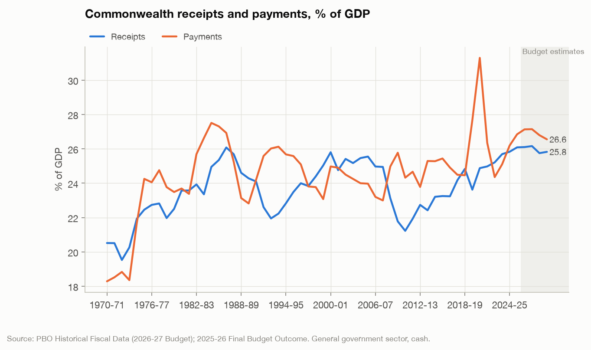
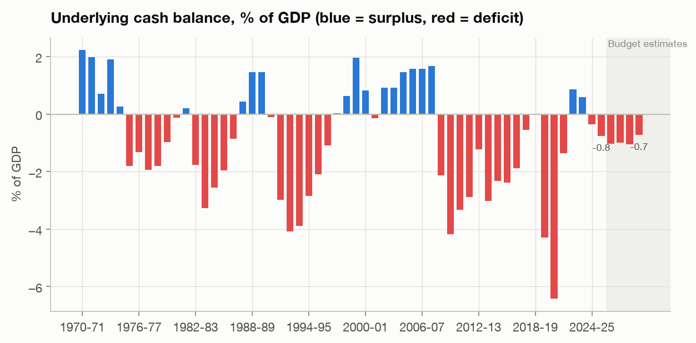

## 2. Where the money goes (granular)

Total expenses were **$812.1b** in 2025-26. Spending is highly concentrated: the ten largest of 69
sub-functions account for **69%** of the total. The single largest line, "general purpose
inter-government transactions", is mostly **GST passed straight to the states**. The Commonwealth collects it but
cannot spend it.

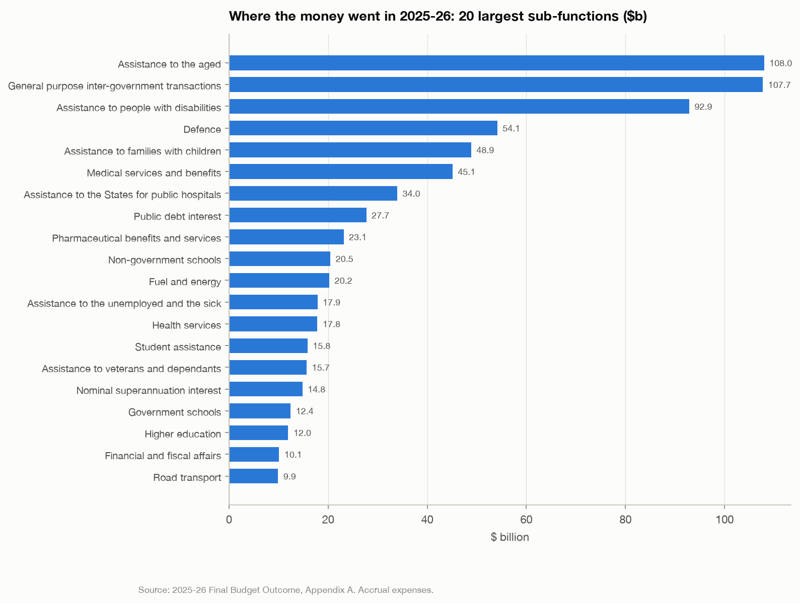

At program level (Portfolio Budget Statements, ~1,100 line items; full table in `tables/pbs_programs_2026_27.csv`):

| Agency | Program | 2026-27 $b | 2029-30 $b | Growth % |
|---|---|---|---|---|
| Department of the Treasury | Commonwealth-State Financial Relations | 171.7 | 193.3 | 12.6 |
| Department of Social Services | Support for Seniors | 68.7 | 77.0 | 12.1 |
| Department of the Treasury | Economic Management | 59.5 | 63.9 | 7.3 |
| Department of Health, Disability and Ageing | Aged Care Services | 43.8 | 50.7 | 15.9 |
| Department of Health, Disability and Ageing | National Disability Insurance Scheme | 42.3 | 42.0 | -0.9 |
| Department of Health, Disability and Ageing | Medical Benefits | 37.6 | 41.5 | 10.4 |
| Australian Office of Financial Management | Commonwealth Debt Management | 31.9 | 46.9 | 47.0 |
| Department of Social Services | Working Age Payments | 27.1 | 27.7 | 2.0 |
| Department of Social Services | Financial Support for People with Disability | 26.3 | 29.5 | 12.4 |
| Department of Health, Disability and Ageing | Pharmaceutical Benefits | 23.4 | 23.8 | 1.5 |
| Department of Education | Non-Government Schools National Support | 21.4 | 24.5 | 14.5 |
| Department of Social Services | Support for Families | 18.2 | 19.2 | 5.8 |
| Department of Education | Child Care Subsidy | 16.9 | 21.1 | 24.7 |
| Department of Social Services | Financial Support for Carers | 13.4 | 15.3 | 13.9 |
| Department of Defence | Program 2.6 Army Capabilities | 13.3 | 14.8 | 11.7 |

*PBS program totals are gross of some intra-government flows and won't sum exactly to GGS expenses. Use them for
ranking and change, not for totals.*

## 3. Has spending really been cut? Three lenses

The political argument usually compares a number with a different baseline. This model reports every line
three ways:

1. **Nominal**: dollars this year vs last year.
2. **Standstill (real per person)**: what it would cost to deliver the *same real service per person*, i.e. last
   year's spend grown by CPI and population. Spending below this line is a real cut per person even if the dollars rose.
3. **Versus the previous forecast**: what governments usually mean by "savings" (section 4).

From 2022-23 to 2025-26, total expenses grew **27.5%** in dollars: prices
**10.7%**, population **5.3%**, leaving a **real per-person increase of
9.4%**. The real per-person growth is concentrated in
social security and welfare ($32.1b), education ($11.4b), fuel and energy ($9.0b), health ($7.8b). Education is inflated by a one-off: *Student
assistance* jumped to $15.8b in 2025-26,
consistent with the 20% HELP debt reduction being booked as an expense. Fuel & energy more than doubled; drill into
`programs` to see which lines drove it:

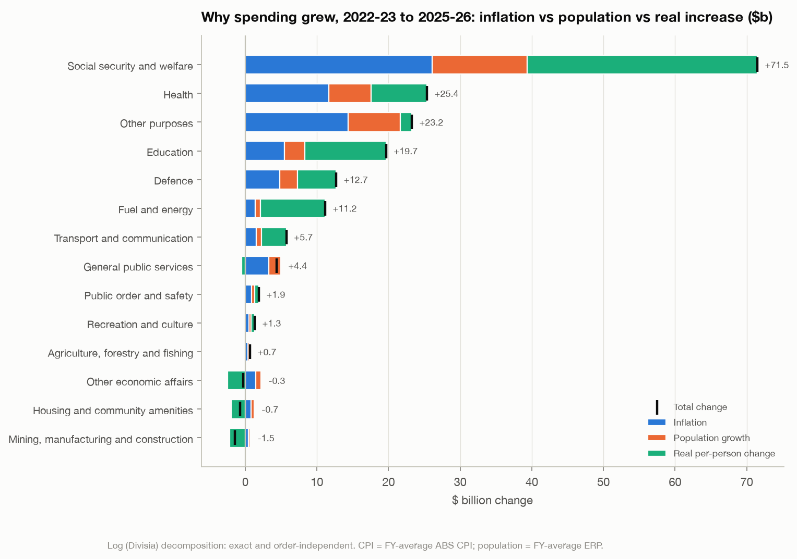

**Looking forward (2025-26 to 2029-30), the Budget's own estimates** classify the 73 sub-functions as:
20 real per-person increases,
13 that *rise in dollars but are real per-person cuts*, and
40 nominal cuts. The largest sub-functions, sorted by distance from standstill:

| Sub-function | 2025-26 $m | 2029-30 $m | Nominal growth % p.a. | Real per-person % | Verdict |
|---|---|---|---|---|---|
| Student assistance | 15,839 | 7,263 | -17.7 | -60.8 | Nominal cut |
| Fuel and energy | 20,248 | 17,256 | -3.9 | -27.2 | Nominal cut |
| Assistance to people with disabilities | 92,867 | 103,356 | 2.7 | -4.9 | Rises in $, but a real per-person cut |
| Road transport | 9,897 | 7,246 | -7.5 | -37.4 | Nominal cut |
| Assistance to veterans and dependants | 15,684 | 14,405 | -2.1 | -21.5 | Nominal cut |
| Natural disaster relief | 3,245 | 129 | -55.3 | -96.6 | Nominal cut |
| Assistance to the unemployed and the sick | 17,852 | 18,069 | 0.3 | -13.5 | Rises in $, but a real per-person cut |
| Rail transport | 5,434 | 3,922 | -7.8 | -38.3 | Nominal cut |
| Other public order and safety | 7,298 | 6,291 | -3.6 | -26.3 | Nominal cut |
| Pharmaceutical benefits and services | 23,143 | 24,840 | 1.8 | -8.3 | Rises in $, but a real per-person cut |
| Medical services and benefits | 45,091 | 50,578 | 2.9 | -4.2 | Rises in $, but a real per-person cut |
| Foreign affairs and economic aid | 9,264 | 8,650 | -1.7 | -20.2 | Nominal cut |
| Health services | 17,841 | 18,701 | 1.2 | -10.4 | Rises in $, but a real per-person cut |
| General administration (Social security and welfare) | 5,826 | 4,722 | -5.1 | -30.7 | Nominal cut |
| Financial and fiscal affairs | 10,107 | 9,766 | -0.9 | -17.4 | Nominal cut |
| Immigration | 4,312 | 3,300 | -6.5 | -34.6 | Nominal cut |
| Defence | 54,130 | 61,860 | 3.4 | -2.4 | Rises in $, but a real per-person cut |
| General administration (Health) | 5,427 | 5,037 | -1.8 | -20.7 | Nominal cut |
| Assistance for Indigenous Australians nec | 3,546 | 3,121 | -3.1 | -24.8 | Nominal cut |
| Other economic affairs nec | 3,763 | 3,438 | -2.2 | -21.9 | Nominal cut |
| General research | 4,281 | 4,139 | -0.8 | -17.4 | Nominal cut |
| Government superannuation benefits | 5,942 | 6,331 | 1.6 | -9.0 | Rises in $, but a real per-person cut |
| Nominal superannuation interest | 14,807 | 17,092 | 3.7 | -1.4 | Rises in $, but a real per-person cut |
| Government schools | 12,434 | 14,733 | 4.3 | 1.2 | Real per-person increase |
| Higher education | 11,951 | 14,198 | 4.4 | 1.5 | Real per-person increase |
| Non-government schools | 20,453 | 24,544 | 4.7 | 2.5 | Real per-person increase |
| Mining, manufacturing and construction | 3,690 | 5,624 | 11.1 | 30.2 | Real per-person increase |
| Housing | 3,839 | 5,867 | 11.2 | 30.6 | Real per-person increase |
| Assistance to families with children | 48,861 | 58,794 | 4.7 | 2.8 | Real per-person increase |
| Assistance to the aged | 107,968 | 130,325 | 4.8 | 3.1 | Real per-person increase |
| General purpose inter-government transactions | 107,717 | 130,674 | 4.9 | 3.7 | Real per-person increase |
| Assistance to the States for public hospitals | 33,951 | 47,205 | 8.6 | 18.8 | Real per-person increase |
| Public debt interest | 27,716 | 46,873 | 14.0 | 44.5 | Real per-person increase |

> **Read this with section 4 in mind.** Forward-estimate "cuts" are often artefacts: terminating programs drop out,
> one-offs (the 2025-26 HELP debt reduction in *Student assistance*, disaster payments) roll off, and decisions
> not yet announced sit in the contingency reserve. History shows these projections are revised up, not down.

## 4. Forecasts vs outcomes: the "cut" that wasn't

When a budget says spending on X is "lower than previously forecast", it is comparing against a forecast, not
against last year. Comparing every budget update since 2023-24 with what actually happened gives:

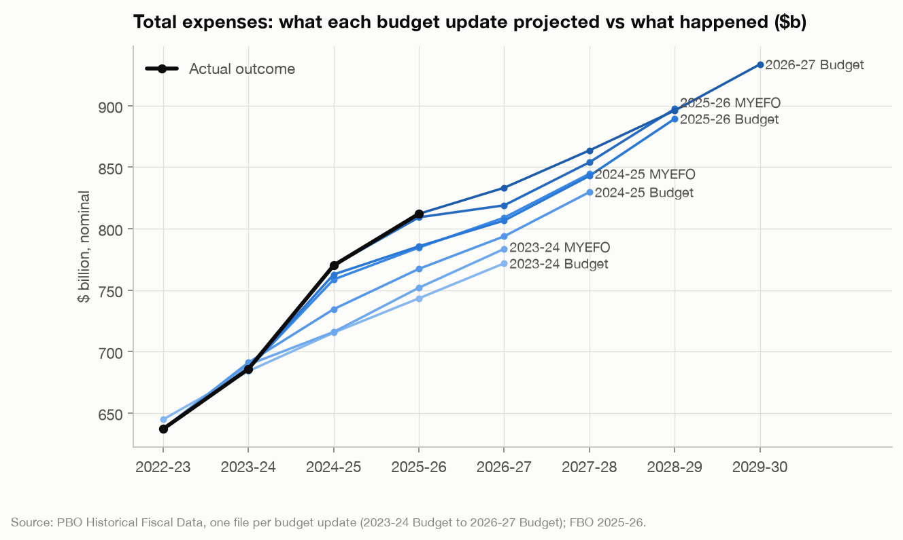

* The **2023-24 Budget** projected 2025-26 expenses of **$743.3b**. The
  outcome was **$812.1b**, i.e. **$68.8b
  (9.3%) higher**.
* One year ahead, Budget forecasts of total expenses have been too low by an average of
  **6.7%** ($49.8b) across the vintages we can score so far.
* The biggest repeated under-forecasts (average of 1- and 2-year-ahead errors) are in:
  Social security and welfare ($16.4b, +6%), Health ($15.9b, +14%), Education ($7.9b, +15%), Defence ($4.1b, +9%), General public services ($3.7b, +12%), Fuel and energy ($3.2b, +26%).

Caveats: this is a short window (outcomes 2022-23 to 2025-26), it includes the 2022-24 inflation surprise (which
mechanically lifts indexed payments), and 2024-25 includes large non-cash accounting items (e.g. a revaluation in
veterans' entitlements and a one-off in *Health services*). The longer record (section 4 of `assessment.md`; `forecast_error_summary`) shows pre-COVID
forecasts were close to unbiased and the under-forecasting is a post-2020 phenomenon, split roughly half policy
decisions and half parameter variations.
Full tables: `tables/forecast_errors_*.csv`.

## 5. Where the tax comes from

In 2025-26, personal income tax raised **53%** of tax receipts, companies **21%**,
GST **14%** (passed to the states), super funds **5%**, and excise and customs
**5%**. Personal income tax has risen from **11.3% of GDP in 2020-21
to 12.7%** and the Budget has it reaching 13.2% by 2029-30. Strong employment and
bracket creep (wages rising into higher brackets with unindexed thresholds) drive this; the 2024 Stage 3 cuts
only briefly reversed it. Tobacco excise has collapsed as the illicit market has grown.

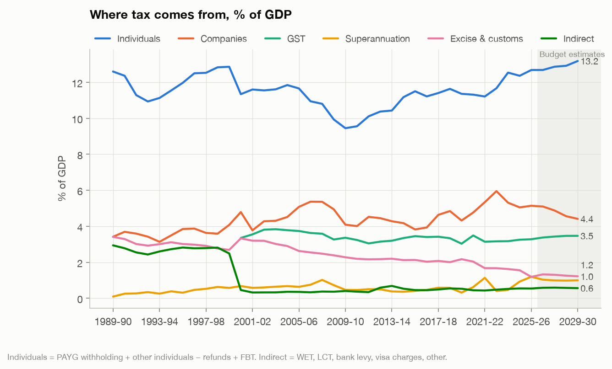

| Head | 2019-20 $b | 2025-26 $b | 2029-30 $b | Growth to 2029-30 % |
|---|---|---|---|---|
| PAYG withholding (wages) | 214.4 | 316.0 | 391.1 | 23.8 |
| Company tax | 84.8 | 149.2 | 151.6 | 1.6 |
| GST | 60.3 | 96.1 | 120.2 | 25.1 |
| Other individuals & trusts (non-wage) | 43.7 | 91.1 | 114.3 | 25.4 |
| Other non-tax (incl. sales of goods & services) | 27.4 | 42.7 | 48.1 | 12.8 |
| Superannuation fund taxes | 6.3 | 35.0 | 34.6 | -1.1 |
| Diesel | 12.0 | 15.2 | 21.4 | 40.6 |
| Other taxes (incl. bank levy, visa charges) | 8.5 | 13.0 | 16.3 | 25.6 |
| Interest received | 3.2 | 9.4 | 10.5 | 12.6 |
| Dividends | 7.0 | 8.2 | 9.9 | 21.0 |
| Petrol | 5.7 | 6.3 | 8.1 | 27.8 |
| Fringe benefits tax | 3.9 | 5.2 | 6.6 | 25.9 |

## 6. Tax concessions: revenue the system chooses not to collect

Treasury estimates about 277 concessions in 2025-26. By tax: Capital gains tax $83.7b, Superannuation $65.0b, Personal income tax $36.7b, GST $33.8b, Fringe benefits tax $9.9b, Business income tax $3.1b, Excise, customs & other indirect $-0.1b, Natural resource taxes $-0.7b.
The largest are housing (main-residence CGT exemption), superannuation, and the CGT discount:

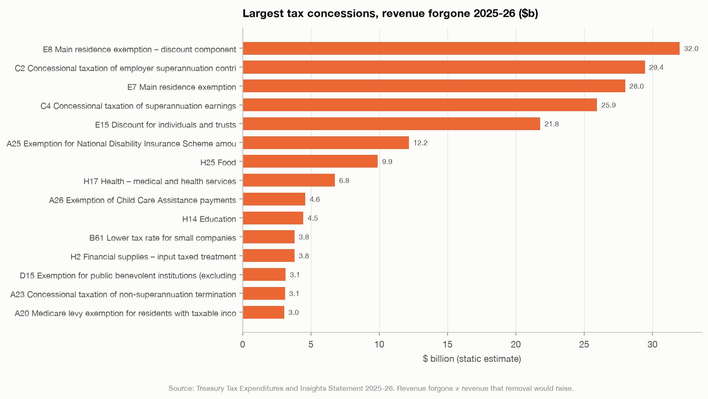

These are **static** estimates. Removing a concession changes behaviour (people hold assets longer, restructure,
contribute less to super), so the revenue raised is smaller. The scenario engine applies an explicit,
uncertain behavioural haircut to each one.

## 7. What would balance the budget?

The baseline deficit in 2029-30 is **$25.3b**. Every estimate below includes **macro feedback**: a
consolidation removes demand, GDP falls by a fiscal multiplier (0.4–1.0 for spending, lower for taxes on capital
income), fading as monetary policy offsets it, and the budget's automatic stabilisers give back about 0.45 of the GDP
loss. "Static" shows the arithmetic without that feedback. Three ways to see the size of the gap:

* **Across-the-board cut:** a uniform **3.5%** cut to all program spending from 2026-27
  (72 sub-functions, excluding debt interest, GST payments to states, super liabilities and the
  contingency reserve) balances 2029-30 (3.0% static). Balancing earlier, in 2027-28,
  needs **5.5%**, because the GDP hit is freshest in the near years.
* **Growth cap:** the Budget already assumes program spending falls **1.9% a
  year** in real per-person terms over 2025-26–2029-30, well below historical norms (section 4). Balancing by
  spending restraint alone would need **2.9% a year**.
* **A package** of five options below (hospital funding at standstill, two super changes, fuel & energy, defence)
  improves 2029-30 by **$23.9b** (80% range $23.0b to
  $24.8b), enough to reach a 2029-30 balance of
  **$-1.3b**.

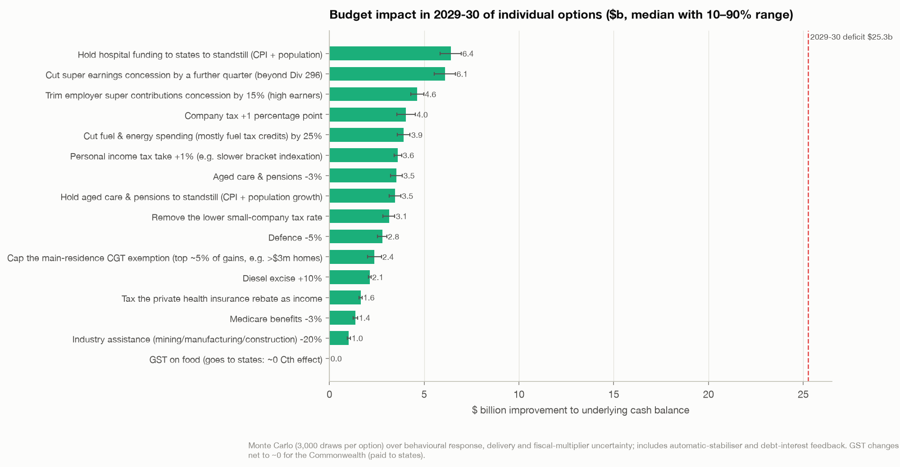

| Option | Static $m | P10 $m | Median $m | P90 $m | % of 2029-30 deficit |
|---|---|---|---|---|---|
| Hold hospital funding to states to standstill (CPI + population) | 7,261 | 5,849 | 6,415 | 6,956 | 25 |
| Cut super earnings concession by a further quarter (beyond Div 296) | 6,494 | 5,531 | 6,112 | 6,645 | 24 |
| Trim employer super contributions concession by 15% (high earners) | 4,915 | 4,306 | 4,629 | 4,977 | 18 |
| Company tax +1 percentage point | 4,260 | 3,559 | 4,033 | 4,539 | 16 |
| Cut fuel & energy spending (mostly fuel tax credits) by 25% | 4,487 | 3,575 | 3,920 | 4,259 | 16 |
| Personal income tax take +1% (e.g. slower bracket indexation) | 3,995 | 3,411 | 3,619 | 3,812 | 14 |
| Aged care & pensions -3% | 4,048 | 3,227 | 3,539 | 3,843 | 14 |
| Hold aged care & pensions to standstill (CPI + population growth) | 3,944 | 3,165 | 3,471 | 3,766 | 14 |
| Remove the lower small-company tax rate | 3,389 | 2,827 | 3,149 | 3,450 | 12 |
| Defence -5% | 3,187 | 2,542 | 2,788 | 3,028 | 11 |
| Cap the main-residence CGT exemption (top ~5% of gains, e.g. >$3m homes) | 2,510 | 2,011 | 2,366 | 2,741 | 9 |
| Diesel excise +10% | 2,334 | 2,058 | 2,129 | 2,199 | 8 |
| Tax the private health insurance rebate as income | 1,878 | 1,565 | 1,647 | 1,727 | 7 |
| Medicare benefits -3% | 1,577 | 1,256 | 1,378 | 1,497 | 5 |
| Industry assistance (mining/manufacturing/construction) -20% | 1,176 | 936 | 1,026 | 1,115 | 4 |
| GST on food (goes to states: ~0 Cth effect) | 0 | 0 | 0 | 0 | 0 |

**Already in the baseline, so not listed as options:** the 2026 tax package and NDIS reforms are in the forward
estimates. CGT: 50% discount replaced by cost-base indexation + 30% minimum tax from 1 Jul 2027 (gains before that date keep the discount; new-build investors may opt for the discount) (Tax Reform No.1 Act, passed 25 Jun 2026); Negative gearing limited to new builds for established properties bought after 12 May 2026 (from 1 Jul 2027) (Tax Reform No.1 Act, passed 25 Jun 2026); Division 296: 30% on super earnings for balances >$3m, 40% >$10m, from 1 Jul 2026 (Act No. 8 of 2026 (13 Mar 2026)); 30% minimum tax on discretionary trusts from 1 Jul 2028 (announced; exposure draft 7 Sep 2026); NDIS 'Securing the NDIS' reforms (functional-capacity access from 1 Jan 2028; 5-6% growth target) (passed Senate Aug 2026).

Assumptions are explicit in `src/auseconomy/scenarios.py` (`option_menu`). Behavioural ranges are judgement,
informed by Treasury/PBO practice. Change them, add levers, or build your own packages:

```python
from auseconomy import scenarios as S
r = S.run([S.TaxConcession(["E15"], share=0.5), S.Spend("Defence", pct=-0.05)])
r.ucb        # P10/P50/P90 underlying cash balance by year
r.summary()  # per-lever central contribution
```

## 8. Inflation: what the data says about government spending

**Where we are (Jun 2026 quarter):** headline CPI **3.9%**, trimmed mean **3.6%**
(above the 2–3% target), wages **3.2%**, so real wages are **falling again (-0.7pp)**.
The cash rate has been raised back to **4.25%**. Public demand is **28.9% of GDP**,
a record outside COVID.

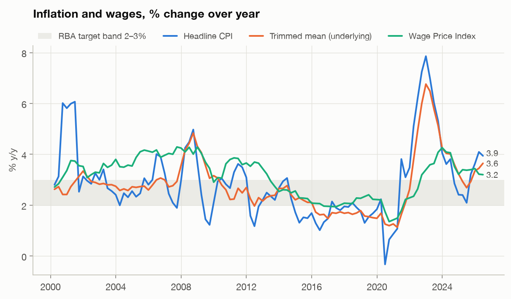
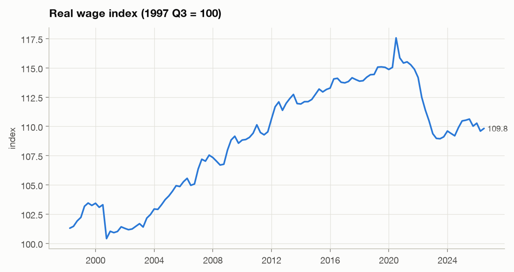
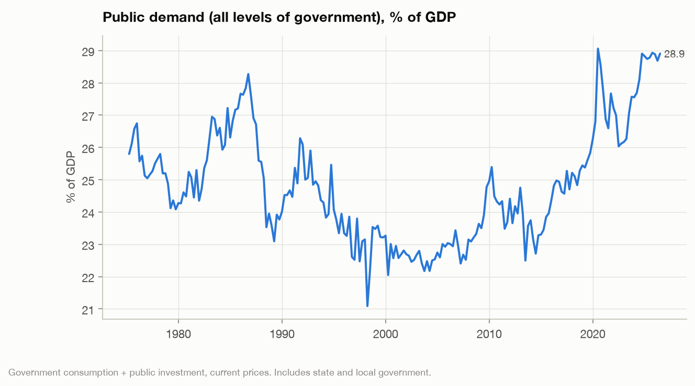

**Does faster public spending growth predict higher inflation?** Tested four ways, 1994–2026, using quarterly
trimmed-mean inflation:

1. **Augmented Phillips curve** (HAC OLS; lagged inflation, expectations, real-time unemployment gap, private demand,
   real cash rate, terms of trade, GST & COVID dummies). The summed effect of public demand growth is
   **+0.068pp of annualised inflation per 1pp of public demand growth** (s.e. 0.045,
   p = 0.13; joint test p = 0.08). That is a small positive effect, borderline significant.
   Adjusted R² goes from 0.613 to 0.616.
2. **Granger causality:** public demand p = 0.12 at best lag; private demand
   p = 0.04. Private demand has stronger predictive content.
3. **Local projections** (dynamic response, robust to lag misspecification): after 8 quarters, 1pp faster public
   demand growth is associated with **+0.024pp** (90% CI -0.020 to +0.068) higher average
   inflation; private demand **+0.120pp** (+0.063 to +0.177).
4. **Out-of-sample forecasting** (expanding window from 2008, 4 quarters ahead): adding public demand does **not**
   improve forecasts (Diebold-Mariano p = 0.24). A simple autoregression beats every structural model.
   This is a common finding for inflation.

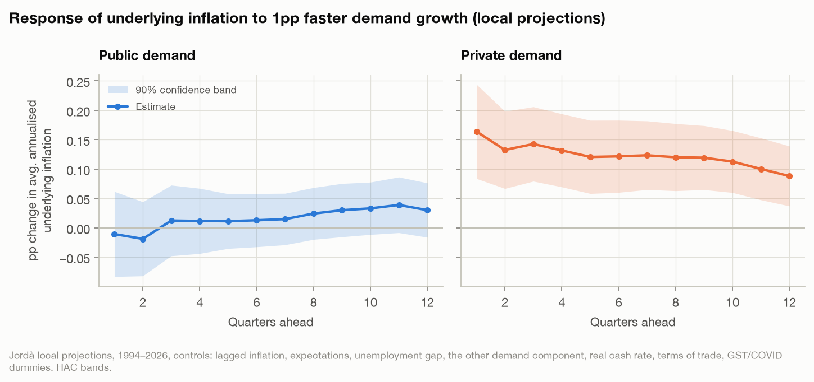

| Model | RMSE (pp) | RMSE ex-COVID | Relative to random walk |
|---|---|---|---|
| AR | 1.081 | 0.730 | 0.911 |
| Phillips curve | 1.327 | 0.927 | 1.119 |
| Phillips + public demand | 1.331 | 0.931 | 1.122 |
| Random walk | 1.186 | 0.853 | 1.000 |

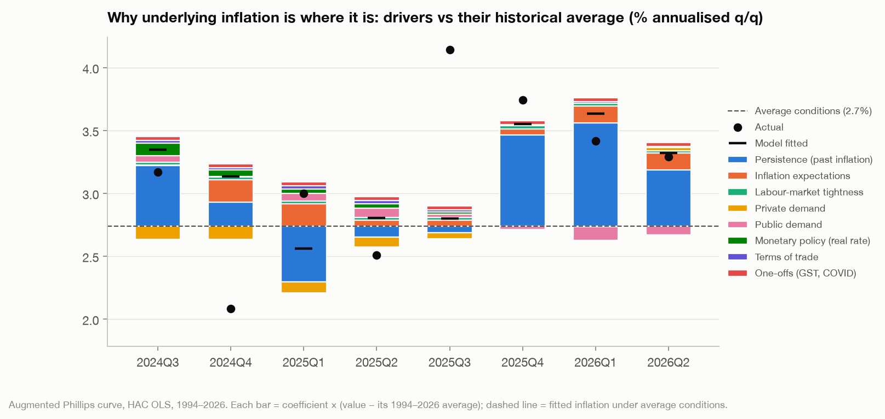

**What this means for "how do we get inflation down":**

* In this data, inflation is dominated by **persistence and expectations**. Once inflation is high, it stays high, and
  the 1-year-ahead expectations term carries a large weight. Measured slack (unemployment gap) has had little explanatory
  power since the 1990s: the Phillips curve is flat.
* The **marginal link from public demand growth to inflation is positive but small and imprecise**: roughly
  0.02–0.07pp per 1pp of extra public demand growth, statistically fragile, and absent out-of-sample. A large, sustained
  fiscal tightening would still remove demand. The evidence just doesn't support big inflation dividends from modest
  spending restraint on its own.
* These are **conditional associations, not causal effects.** Government spending responds to the economy
  (e.g. COVID), and the RBA reacts to fiscal policy, which hides any direct effect. A credible causal estimate
  needs identified fiscal shocks (narrative/defence-news or Blanchard-Perotti style). That's the natural next phase.
* The level of *public demand relative to capacity* (not its growth) and its composition (e.g. care-economy wages, energy
  rebates that cut measured CPI temporarily) are channels this first model doesn't capture.

Stationarity checks (ADF/KPSS) are in `tables/`, along with the coefficient table and forecast accuracy.

## 9. Method, data and caveats

**Sources:** PBO Historical Fiscal Data (7 vintages, 2023-24 Budget to 2026-27 Budget), 2025-26 Final Budget
Outcome (Sep 2026), 2026-27 Budget Paper 1 tables, 2025-26 & 2026-27 Portfolio Budget Statements line items
(data.gov.au), Treasury Tax Expenditures and Insights Statement 2025-26, ABS Data API (CPI, WPI, national accounts,
labour force, population), RBA statistical tables (cash rate, bond yields, inflation expectations).

**Measurement choices:**
* **Real terms:** FY-average CPI, 2025-26 base. Forward years use the inflation rate implied by Treasury's
  own "real growth in payments", which matches ABS outturns to within ~0.03pp in history.
* **Per person:** FY-average estimated resident population; forward years backed out of BP1 Table 11.11.
* **Growth decomposition:** log (Divisia), so the parts sum exactly to the dollar change.
* **Sub-functions** follow the current Budget Paper classification; any gap between the parts and the published
  function total is carried as an explicit residual so totals always reconcile (checked against the FBO).
* Expenses are accrual, the deficit (UCB) is cash; scenarios treat expense changes as same-year cash changes.

**Rebuild everything:** `uv run auseconomy all`. Query the database directly:
`duckdb data/auseconomy.duckdb` or `from auseconomy.build import load`.
